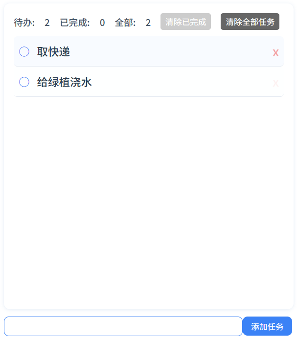
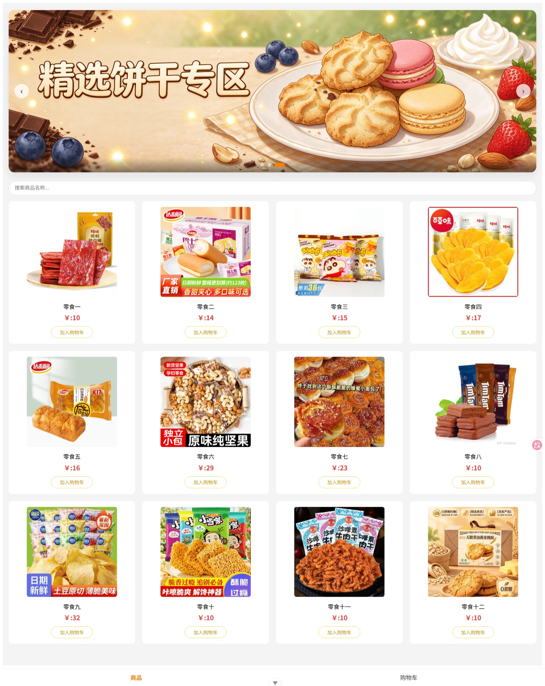
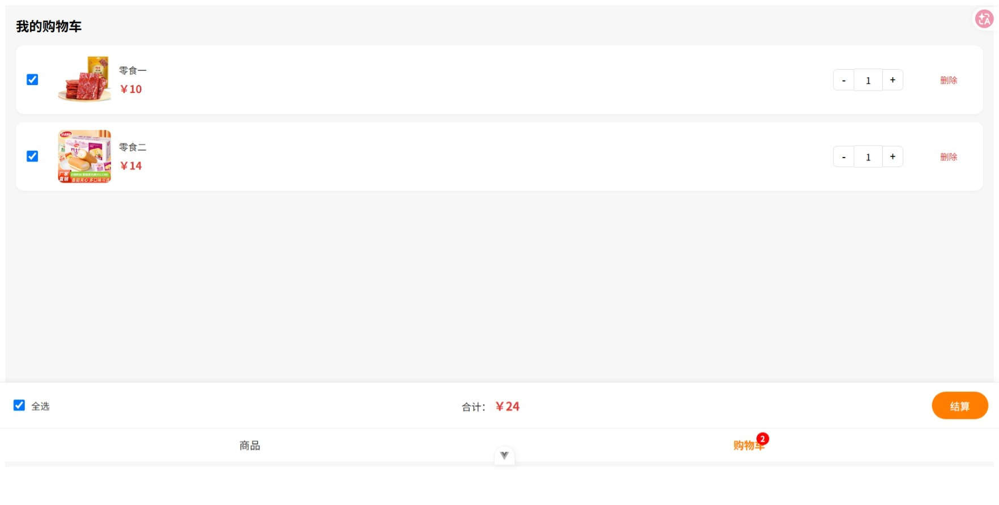

# vue-project

Vue 3 练手小项目集合，用于学习 Vue 3 + Vite 全家桶的基础用法。

## 📁 项目列表

### 1. todo-list（`vue-toolistProject`）

待办清单，一个纯 Vue 3 Composition API 的单文件示例（单组件 `App.vue`）。



**功能：**

- 添加任务：回车 / 按钮触发，空输入自动过滤
- 删除任务：点击 x 删除对应项
- 标记完成：点击圆圈切换完成 / 待办状态
- 行内编辑：点击任务文字进入编辑（Enter 保存、Esc 取消、失焦保存）
- 任务统计：待办数 / 已完成数 / 全部数
- 任务排序：未完成任务排在前面
- 清除功能：清除已完成、清除全部（按钮带禁用态处理）
- `localStorage` 本地持久化

**技术栈：** Vue 3（`<script setup>`、`ref`、`computed`、`nextTick`）+ Vite

### 2. snackShopCart（`vue-snacksShopCart`）

零食商城 + 购物车，一个更完整的多页面 SPA 示例。




**功能：**

- 商品列表页：轮播图 Banner、商品展示、加入购物车
- 购物车页：商品增减、单选 / 全选、删除，实时计算总价与总件数
- Vue Router 页面路由（`/goods` 商品列表、`/cart` 购物车，默认重定向到商品页）
- Pinia 状态管理购物车，`pinia-plugin-persistedstate` 持久化

**技术栈：** Vue 3 + Vue Router + Pinia + pinia-plugin-persistedstate + Vite + vue-devtools


后续可扩展 
- [ ] 商品详情弹窗（大图 + 描述 + 规格）
- [ ] 结算成功页 / 订单记录页
- [ ] 商品分类筛选 + 价格排序
- [ ] 库存为 0 时按钮置灰
- [ ] 骨架屏 + 加载状态
- [ ] 接入真实后端接口（axios）


## 3.轮播图（vue-carousel）
**功能：**
-图片自动播放，手动：上一张、下一张、点击小圆点


## 🚀 运行项目

> 环境要求：Node.js `^22.18.0 || >=24.12.0`

```bash
# 进入对应项目目录
cd vue-toolistProject     # 待办清单
# 或
cd vue-snacksShopCart     # 零食商城购物车

# 安装依赖
npm install

# 启动开发服务器
npm run dev

# 构建生产版本
npm run build
```

## 📝 学习要点

### todo-list（vue-toolistProject）

- **Composition API 基础**：`<script setup>` 语法糖、`ref` 响应式引用、`computed` 计算属性
- **事件处理**：`@click` / `@keydown.enter` / `@keydown.esc` / `@blur` 等多种事件绑定
- **条件渲染与列表渲染**：`v-if` / `v-else` 切换编辑态、`v-for` 渲染任务列表、`:key` 的使用
- **class 动态绑定**：`:class="{done: task.done}"` 根据状态切换样式
- **表单双向绑定**：`v-model` 绑定输入框与编辑框
- **DOM 更新时机**：`nextTick` 配合 `ref` 获取编辑框并自动聚焦
- **localStorage 持久化**：`JSON.parse` / `JSON.stringify` 序列化存取，封装工具函数
- **数组方法实战**：`filter`（删除）、`find`（查找）、`unshift`（置顶新增）、`sort`（排序）、`every` / `reduce`（统计）
- **按钮禁用态**：`:disabled` 与计算属性联动，边界情况处理

### snackShopCart（vue-snacksShopCart）

- **Pinia 状态管理**：`defineStore` 定义仓库，`state` / `getters` / `actions` 三段式组织
- **getter 计算逻辑**：选中商品总价（`checked` 过滤累加）、总件数、全选状态判断（`every`）
- **action 业务操作**：加购去重（已存在则数量 +1）、数量增减、删除、全选 / 反全选
- **pinia-plugin-persistedstate**：购物车数据刷新不丢失的持久化方案
- **Vue Router 路由**：`createRouter` + `createWebHistory`、路由重定向、组件懒加载（`() => import(...)`）
- **页面间路由跳转**：`<router-link>` / 编程式导航
- **组件拆分**：MallHeader 顶部导航、BannerSwiper 轮播等可复用组件
- **静态数据驱动渲染**：`data/goods.js` 商品数据 + `v-for` 商品列表渲染

